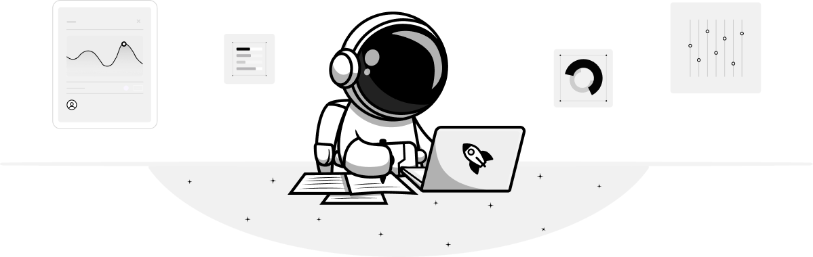
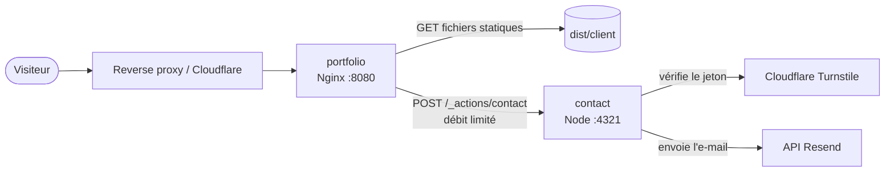

<div align="center">



# Paul Viandier · Portfolio

**Astrophysique, code et cybersécurité.**
Le code source de mon site personnel, construit avec Astro et déployé dans des conteneurs Docker
durcis.

[](https://paulviandier.com)

[](https://astro.build)
[](https://www.typescriptlang.org)
[](https://nodejs.org)
[](https://pnpm.io)
[](https://www.docker.com)
[](https://nginx.org)
[](https://www.cloudflare.com/products/turnstile/)
[](https://resend.com)

[](https://github.com/506f6c6c7578/portfolio/commits/main)
[](https://github.com/506f6c6c7578/portfolio)
[](LICENSE)

[Site web](https://paulviandier.com) · [Fonctionnalités](#fonctionnalités) · [Architecture](#architecture) · [Démarrage](#démarrage) · [Déploiement](#déploiement) · [Sécurité](#sécurité) · [Licence](#licence)

</div>

---

## Fonctionnalités

- **Statique avant tout** : chaque page est prégénérée en HTML, avec des feuilles de style
  intégrées, des polices auto-hébergées (Signika et Heebo) et un préchargement des liens au survol.
- **Thèmes clair et sombre**, navigation responsive et animations d'apparition discrètes au
  défilement.
- **Optimisé pour le référencement** : balises meta, image Open Graph, données structurées JSON-LD,
  sitemap, `robots.txt`, `llms.txt` et manifeste d'application web.
- **Ressources graphiques générées** : les favicons, les icônes PNG et l'image Open Graph sont
  rendus depuis du SVG au moment du build avec `sharp`.
- **Formulaire de contact** reposant sur une action Astro : validation avec Zod, protection
  anti-spam Cloudflare Turnstile et envoi via l'API Resend.
- **Pages légales** : mentions légales et politique de confidentialité générées depuis des
  données typées, avec une mention d'information sous le formulaire de contact.
- **Source de vérité unique** : les métadonnées du site, la navigation, les projets et le contenu
  des pages sont centralisés dans [`src/data`](src/data).

## Architecture

Le build produit deux images à partir d'un seul [`Dockerfile`](Dockerfile) multi-étapes :

| Service     | Image                         | Rôle                                                                     |
|-------------|-------------------------------|--------------------------------------------------------------------------|
| `portfolio` | `nginx-unprivileged` (Alpine) | Sert le site statique précompressé et relaie le point d'accès de contact |
| `contact`   | `node` (Alpine)               | Exécute le serveur Astro autonome qui traite l'action de contact         |



## Stack technique

| Domaine    | Outils                                                                                                     |
|------------|------------------------------------------------------------------------------------------------------------|
| Framework  | [Astro](https://astro.build) avec l'adaptateur Node (mode autonome)                                        |
| Langages   | TypeScript (strict), CSS                                                                                   |
| Validation | [Zod](https://zod.dev) (mini)                                                                              |
| Interface  | Icônes [Lucide](https://lucide.dev), [Simple Icons](https://simpleicons.org), [Motion](https://motion.dev) |
| Images     | [sharp](https://sharp.pixelplumbing.com)                                                                   |
| Services   | Cloudflare Turnstile, Resend                                                                               |
| Exécution  | Docker, Docker Compose, Nginx                                                                              |

## Démarrage

### Prérequis

- [Node.js](https://nodejs.org) 22.23.4 ou plus récent
- [pnpm](https://pnpm.io) 12 (la version exacte est fixée dans `packageManager`, donc
  `corepack enable` suffit)

### Installation

```bash
git clone https://github.com/506f6c6c7578/portfolio.git
cd portfolio
pnpm install
cp .env.example .env
pnpm dev
```

Le site est ensuite accessible sur <http://localhost:4321>.

### Variables d'environnement

| Variable               | Portée           | Description                                                     |
|------------------------|------------------|-----------------------------------------------------------------|
| `RESEND_API_KEY`       | Serveur, secrète | Clé API utilisée pour envoyer les e-mails de contact via Resend |
| `TURNSTILE_SITE_KEY`   | Client, publique | Clé de site Turnstile intégrée au formulaire de contact         |
| `TURNSTILE_SECRET_KEY` | Serveur, secrète | Clé secrète Turnstile utilisée pour vérifier les jetons         |

Les variables sont déclarées et typées via le schéma `astro:env` dans [
`astro.config.ts`](astro.config.ts). Cloudflare fournit
des [clés de test](https://developers.cloudflare.com/turnstile/troubleshooting/testing/) pour le
développement local.

### Scripts

| Commande       | Description                                        |
|----------------|----------------------------------------------------|
| `pnpm dev`     | Lance le serveur de développement                  |
| `pnpm check`   | Vérifie le typage et les diagnostics Astro         |
| `pnpm build`   | Vérifie le typage puis génère le site dans `dist/` |
| `pnpm preview` | Prévisualise le build de production en local       |

## Déploiement

La stack est décrite dans [`compose.yaml`](compose.yaml). Une fois les trois variables
d'environnement définies (dans `.env` ou dans le shell), construis et lance-la avec :

```bash
docker compose up -d --build
```

Les services se contentent d'exposer leurs ports sur le réseau Compose, sans les publier sur l'hôte.
Place un reverse proxy ou un tunnel (par exemple Cloudflare Tunnel) sur le même réseau et redirige
le trafic vers `portfolio:8080`. Nginx lit l'adresse du client depuis l'en-tête `CF-Connecting-IP`
pour la limitation de débit.

## Sécurité

<details>
<summary><strong>Application</strong></summary>

- Content Security Policy à base d'empreintes générée par Astro, limitée par défaut à `self`.
- Liste d'hôtes autorisés et taille maximale des requêtes (32 Kio) côté serveur et pour les actions.
- Chaque champ du formulaire de contact est nettoyé, limité en longueur et validé avec Zod, et le
  sujet refuse les caractères de contrôle.
- Les jetons Turnstile sont vérifiés côté serveur avec l'adresse IP du client avant tout envoi
  d'e-mail.
- Les requêtes sortantes vers Turnstile et Resend ont un délai d'expiration, et les erreurs ne
  révèlent jamais de détails internes au visiteur.

</details>

<details>
<summary><strong>Nginx</strong></summary>

- Seules les méthodes `GET` et `HEAD` sont acceptées, ainsi que `POST` sur `/_actions/contact`.
- Le point d'accès de contact est limité en débit par adresse IP et renvoie une réponse `429`
  structurée.
- En-têtes de sécurité sur chaque réponse : HSTS, `frame-ancestors 'none'`,
  `X-Content-Type-Options`, `X-Frame-Options`, `Referrer-Policy`, `Permissions-Policy` et
  `Cross-Origin-Opener-Policy`.
- Version du serveur masquée, fichiers cachés inaccessibles et taille des requêtes plafonnée.
- Cache long et immuable pour les ressources versionnées, et fichiers gzip précompressés servis
  directement.

</details>

<details>
<summary><strong>Conteneurs</strong></summary>

- Images de base fixées par version et par empreinte SHA-256.
- Contexte de build minimal grâce à un `.dockerignore` en liste blanche.
- Les deux services tournent avec des utilisateurs non root, et les fichiers applicatifs
  appartiennent à `root`.
- Systèmes de fichiers racine en lecture seule, petit `tmpfs` pour `/tmp`, toutes les capacités
  Linux retirées et `no-new-privileges` activé.
- Limites de CPU et de mémoire, et health checks pour chaque service.
- Journaux Docker plafonnés en taille et purgés automatiquement par rotation.

</details>

Tu as trouvé une vulnérabilité ? Signale-la en privé via
le [formulaire de contact](https://paulviandier.com/contact) plutôt que d'ouvrir une issue
publique.

## Structure du projet

```text
.
├── docker/               Configuration du serveur Nginx et en-têtes de sécurité
├── src/
│   ├── actions/          Actions Astro (traitement du formulaire de contact)
│   ├── assets/           Illustrations et images
│   ├── components/       Composants Astro
│   ├── data/             Métadonnées du site, navigation, projets et contenu des pages
│   ├── layouts/          Mise en page de base
│   ├── lib/              Utilitaires (ressources graphiques, CSP, Resend, Turnstile, URL)
│   ├── pages/            Routes, dont les icônes, le manifeste et llms.txt générés
│   ├── scripts/          Scripts client (thème, navigation, animations, formulaire)
│   └── styles/           Feuille de style globale
├── astro.config.ts
├── compose.yaml
└── Dockerfile
```

## Licence

© 2026 Paul Viandier. Tous droits réservés.

Ce dépôt est public uniquement pour être consulté. Toute copie, modification, redistribution ou
réutilisation, même partielle, du code, des textes ou des visuels est interdite sans autorisation
écrite préalable. Consulte le fichier [`LICENSE`](LICENSE) pour le détail, ou écris-moi via
le [formulaire de contact](https://paulviandier.com/contact) pour toute demande.

## Contact

<div align="center">

[](https://paulviandier.com)
[](https://paulviandier.com/contact)
[](https://github.com/506f6c6c7578)

</div>
